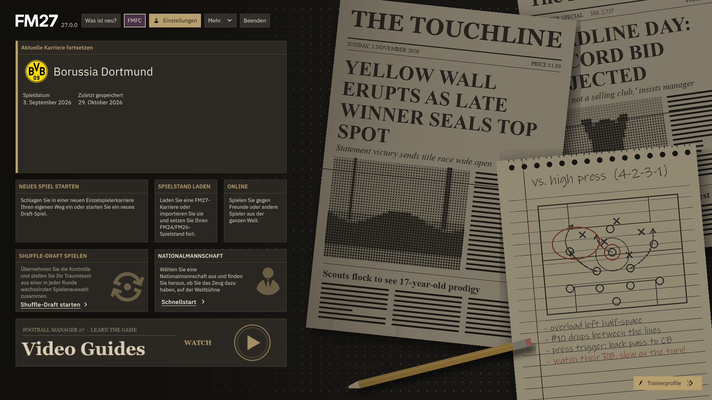
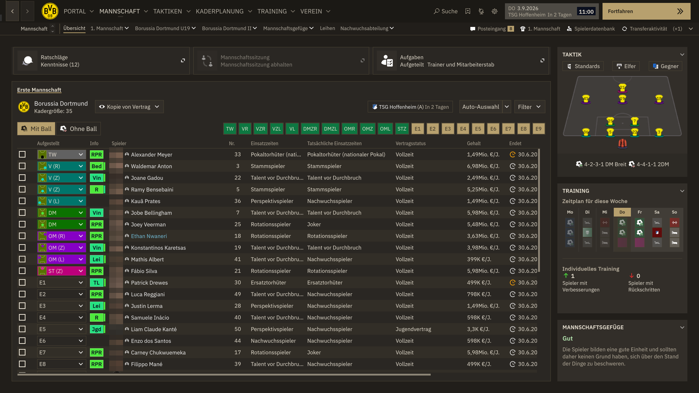
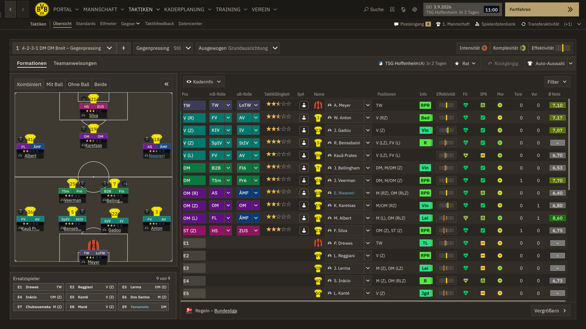
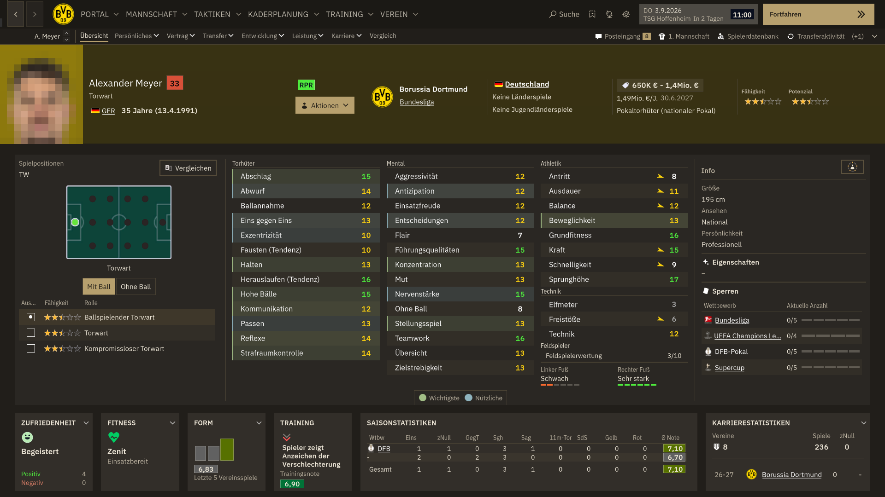
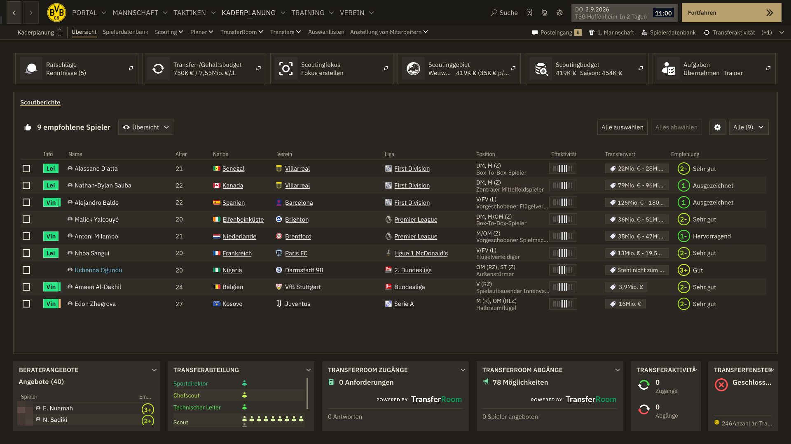

# Scout Notizbuch: a Football Manager 27 skin



A dark, warm skin that makes FM27 look like a scout's notebook: deep beige
paper, cream ink, thin gold rules and IBM Plex type. The start screen is a
scout's desk with English newspapers, a notebook with a tactics sketch, and a
pencil.

The look is inspired by my personal website,
[leon-burghardt.dev](https://leon-burghardt.dev).

> Work in progress, tested against the **FM27 demo / launch preview** at
> 1920×1080. Some screens may still show default styling.

## Screenshots

| Squad | Tactics |
| --- | --- |
|  |  |
| **Player profile** | **Scouting** |
|  |  |

Player photos are pixelated in the screenshots. The skin itself leaves them unchanged.

## Installation

1. Download this repository: **Code → Download ZIP**, then extract it.
   You can also clone it with `git clone`.
2. Copy the **`Scout Notizbuch`** folder into your FM27 `skins` folder:
   - **Windows:** `Documents\Sports Interactive\Football Manager 27\skins\`
   - **macOS:** `~/Library/Application Support/Sports Interactive/Football Manager 27/skins/`

   Create the `skins` folder if it does not exist. If your Documents folder is
   redirected to OneDrive, use the folder inside OneDrive.
3. Check the folder layout. `skin.json` and `main.uss` must sit directly in
   `skins/Scout Notizbuch/`:

   ```
   skins/
   └── Scout Notizbuch/
       ├── skin.json
       ├── main.uss
       ├── theme-scout.uss
       ├── custom.uss
       ├── styles/
       ├── fonts/
       └── assets/
   ```
4. Start FM27 and open **Preferences → Interface → Skin**. Select
   **Scout Notizbuch** and confirm.
5. Restart the game once. The start screen and loading screens only switch
   over fully after a restart.

### Updating

Replace the `Scout Notizbuch` folder with the new version, then restart FM27.
Skins have no hot reload. After editing, re-select the skin in Preferences or
restart the game.

## Customising

| File | What it controls |
| --- | --- |
| `theme-scout.uss` | All colours, fonts, font sizes and radii. Change the palette here. |
| `custom.uss` | Start screen, loading screens, header icons. Loaded last, so put your own rules here. |
| `assets/backgrounds/` | Start-screen desk (`scout-desk.png`) and the video-guides strip |
| `EDITING.md` | Detailed guide to the stylesheet structure (from the base template) |

When you change a base colour in `theme-scout.uss`, also update its matching
`-alpha-*` variants. They use the same RGB values with a different opacity.

The `tools/` folder has the Python scripts that generate the palette and
artwork, plus a small helper that takes screenshots of the running game.
You don't need them to use the skin.

## Credits

- **Base template:** [FM Dugout Template](https://github.com/lotsgon/fm27-dugout-skin-public)
  by lotsgon. Its stylesheet structure and native class mappings do most of
  the heavy lifting.
- **Fonts:** [IBM Plex](https://github.com/IBM/plex) by IBM Corp. and Poppins by
  the Indian Type Foundry. Both are under the SIL Open Font License 1.1; see
  `Scout Notizbuch/fonts/OFL-*.txt`.
- Football Manager is a trademark of Sports Interactive / SEGA. This is an
  independent community skin, not an official product. Game UI, club marks and
  player likenesses belong to their respective owners.
